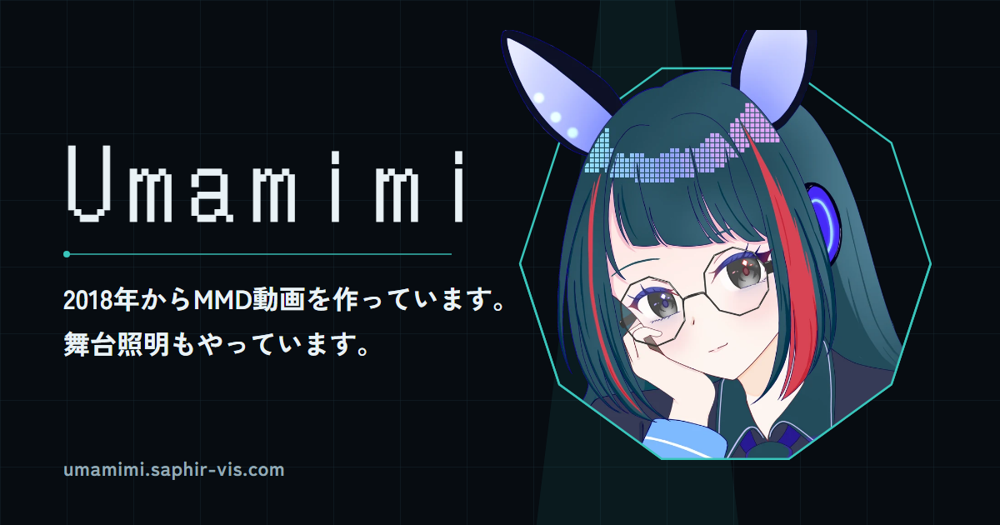
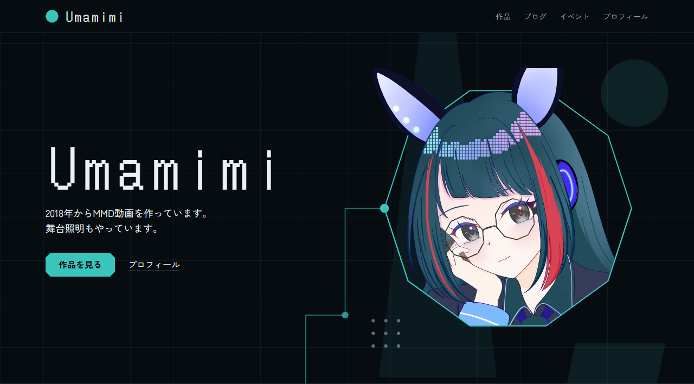
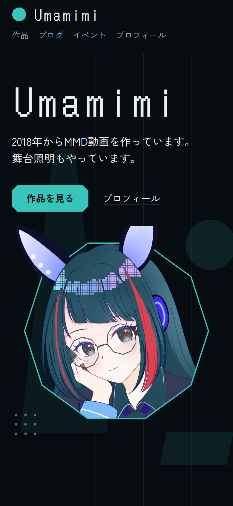
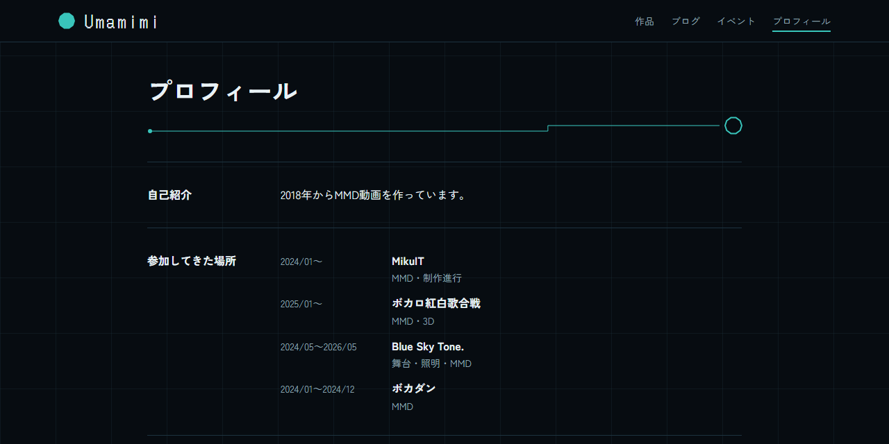
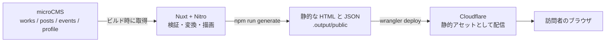

# Umamimi

<p align="center">
  
</p>

<p align="center">
  <strong>2018年からMMD動画を作っています。舞台照明もやっています。</strong>
</p>

<p align="center">
  <a href="https://umamimi.saphir-vis.com">https://umamimi.saphir-vis.com</a>
</p>

<p align="center">
  
  
  
  
  
</p>

Umamimi の作品・ブログ・イベント・プロフィールを、一か所にまとめるポートフォリオサイトのソースコードです。MMD 動画の制作と、舞台照明の活動を続けるなかで、作品の置き場所が分散していたため、Foriio から移行して作りました。

内容は microCMS で管理し、ビルド時に静的なファイルとして書き出して、Cloudflare から配信しています。コードを書かずに、管理画面から作品やイベントを足せる作りです。

## スクリーンショット

<p align="center">
  
  
</p>

<p align="center">
  
</p>

## 主な機能

- **作品**: 動画とプロダクト(ソフトウェアなど)を、同じ一覧で扱います。種類とカテゴリで絞り込めます。動画は、YouTube とニコニコ動画の URL から埋め込みプレーヤーを出します。
- **ブログ**: 自サイトの記事と、外部の記事(note など)へのリンクを、同じ一覧に並べます。カテゴリは複数付けられ、絞り込めます。
- **イベント**: 開催予定と終了したものを分けて表示します。「予定」と「終了」は、開催日から自動で切り替わります。
- **プロフィール**: 自己紹介、参加歴(期間と役割)、リンク集、ご連絡先。連絡先のメールアドレスは、迷惑メール対策のために `[at]` の形で載せています。
- **共有と検索**: ページごとの OGP とタイトル・説明、canonical、`sitemap.xml`、`rss.xml`(作品とブログの新着)、`robots.txt`。
- **プライバシーポリシー**: Google アナリティクスの利用など、情報の取り扱いを説明するページ。
- **専用の 404 ページ**。

## デザイン

「舞台の暗転」を背景に、**照明プラン図(舞台照明の図面)**を、サイト全体のモチーフにしています。

- **基調**: ダークテーマ。キャラクターの髪の青緑と制服の紺を、暗転まで落とした色を使います。アクセントは、ティールの 1 色だけです。
- **記憶に残す 1 点**: ドットフォントの大きなワードマーク「Umamimi」と、十角形の窓から身を乗り出すキャラクター。ほかは静かにしています。
- **図面のモチーフ**: 全ページの背景の方眼、見出しの下に引かれて図形で終わる結線、サムネイルの四隅のトンボ、フッターの縮尺バーなど。どれも、図面としての意味を持たせています。
- **形**: キャラクターの十角形のメガネから、「面取りした角」を作り、サムネイルとボタンの角に使っています。
- **タイポグラフィ**: 表示用に DotGothic16、本文に Zen Kaku Gothic New。どちらも自己ホストで配信しています。
- **動き**: 最初に開いたときの結線の描画(約 2.4 秒)だけです。「視差効果を減らす」の設定では動かさず、JavaScript が無効でも、完成した形を出します。
- **アクセシビリティ**: スキップリンク、見出しの階層、フォーカス枠、現在地を色と下線の両方で示すこと。

## 技術構成

| 項目 | 内容 |
|---|---|
| フレームワーク | [Nuxt](https://nuxt.com/) 4(`nuxt generate` による静的サイト生成)、Vue 3、TypeScript |
| スタイル | [Tailwind CSS](https://tailwindcss.com/) 4(`@tailwindcss/vite`) |
| CMS | [microCMS](https://microcms.io/)(Hobby プラン)。API は 4 つ |
| フォント | `@fontsource/dotgothic16`、`@fontsource/zen-kaku-gothic-new` |
| ホスティング | Cloudflare(Workers のビルドと静的アセット)。`wrangler deploy` で公開 |
| 解析 | Google アナリティクス(GA4)。計測 ID を設定したときだけ有効 |
| 実行環境 | Node.js 24.15 以上 |

## しくみ



- ブラウザから microCMS は呼びません。microCMS の API キーは、ビルド時のサーバー側でだけ使い、公開されるファイルには含まれません。
- microCMS の内容を更新したら、再ビルドして反映します。

## 設計で意識したこと

- **入力ミスは公開する前に止める**: `server/utils/cms-map.ts` で、microCMS から取得した値を検証してから、サイトで使う形(`shared/types/content.ts`)に変換します。必須の項目が空、URL の形が正しくない、種類ごとの条件を満たさない(動画なのに動画 URL が無い、など)ときは、**どのコンテンツのどの項目か**を示してビルドを止めます。取得に失敗したときも止めて、空のサイトを公開しないようにしています。
- **仮データを本番に混ぜない**: microCMS が未設定のとき、開発サーバーは仮データで表示します。一方で、公開用のビルド(`npm run generate`)は、仮データが混ざらないよう止まります。
- **一覧と詳細で、取得する量を変える**: 一覧は本文を取得せず、詳細ページを作るときだけ 1 件ずつ取得します。型も、一覧用(`Work`)と詳細用(`WorkDetail`)に分けています。
- **静的サイトでも「予定/終了」を正しく出す**: 静的に書き出したサイトは、ビルド後に日付が変わっても表示が変わりません。そのため、イベントの「予定」と「終了」は、ブラウザ側で開催日と現在の日付を比べて決めています。日付はすべて日本時間で扱います(`shared/utils/date.ts`)。
- **動画の扱い**: YouTube(閲覧者の追跡を抑える `youtube-nocookie` のドメイン)とニコニコ動画は、URL から埋め込みプレーヤーを出します。どちらでもない URL は、埋め込まず外部リンクとして出します。サムネイルは、未設定なら YouTube の動画から自動で取ります。
- **管理画面の入力で、リンクが壊れないように**: リンクの URL は `http(s)` だけを通します。
- **共有まわりを、コードで再現できるように**: 全ページ共通の OGP 画像は、HTML(`design/ogp/og.html`)から Edge のヘッドレス表示で書き出します(`design/ogp/render.ps1`)。`sitemap.xml`、`rss.xml`、`robots.txt` は、Nitro のルートとして書き、ビルド時に静的なファイルとして出力します。
- **解析は、設定したときだけ**: Google アナリティクスは、環境変数に計測 ID(形式を検証します)があるときだけ読み込みます。ID があるときだけ、フッターに「使っています」と表示します。
- **ホスティングの落とし穴を、設定で固定する**: Cloudflare のビルド環境では、Nitro が出力の種類を自動で `cloudflare-module` に切り替え、静的なサイトなのに存在しないサーバー用のファイルを探してデプロイに失敗しました。`nuxt.config.ts` の `nitro.preset: 'static'` で固定し、`wrangler.jsonc` で、配信するディレクトリ、末尾の `/` の扱い(`/works/` を `/works` へ)、404 ページを明示しています。

## コンテンツモデル(microCMS)

API は 4 つで、Hobby プランの上限(5 つ)に収まります。項目 ID は、コードが値を読むのに使うので、そのまま入力します。

| API(形式) | 主な項目 |
|---|---|
| `works`(リスト) | タイトル `title`、種類 `kind`(動画 / プロダクト)、カテゴリ `category`、公開日 `date`、動画 URL `videoUrl`(動画のとき必須)、サムネイル `thumbnail`、画像(複数)`images`、概要 `summary`、詳細 `body`、関連リンク `links` |
| `posts`(リスト) | タイトル `title`、カテゴリ `category`(複数選択)、種別 `kind`(自サイト記事 / 外部記事リンク)、公開日 `date`、本文 `body`、外部記事の URL `externalUrl` |
| `events`(リスト) | 名称 `name`、開催日 `date`、開催日の表記 `dateText`、場所 `place`、概要 `summary`、詳細 `body`、画像(複数)`images`、関連リンク `links` |
| `profile`(オブジェクト) | 自己紹介 `intro`、参加歴 `history`、リンク `links`、連絡先メール `email` |

`links`(関連リンク)と `history`(参加歴)は、microCMS の繰り返しフィールドで、カスタムフィールド `linkItem`(表示名 `label` と URL `url`)と `historyItem`(名称 `name`、期間 `period`、役割 `role`、補足 `note`)を使います。

## ローカルで動かす

Node.js 24.15 以上が必要です。

```bash
git clone https://github.com/nmst0811/portfolio-Umamimi.git
cd portfolio-Umamimi
npm install
npm run dev
```

`http://localhost:3000` を開きます。**環境変数を設定していなくても、仮データで表示できます**(`server/data/sample.ts`。プロフィール以外は、実際のコンテンツではありません)。

自分の microCMS につなぐときは、上の「コンテンツモデル」の API を作ってから、`.env.example` を `.env` にコピーして、値を入れます。

| コマンド | 内容 |
|---|---|
| `npm run dev` | 開発サーバー(`localhost:3000`)。環境変数が未設定なら、仮データで表示します |
| `npm run generate` | 静的なサイトを `.output/public` に書き出します(公開用のビルド) |
| `MICROCMS_USE_SAMPLE=1 npm run generate` | 仮データのまま書き出して、確かめます(PowerShell では `$env:MICROCMS_USE_SAMPLE=1; npm run generate`) |

OGP 画像を作り直すとき(Windows と Microsoft Edge が必要)は、`powershell -File design/ogp/render.ps1` を実行します。

## 環境変数

| 変数 | 内容 |
|---|---|
| `MICROCMS_SERVICE_DOMAIN` | microCMS のサービスドメイン(`https://XXXX.microcms.io` の `XXXX`) |
| `MICROCMS_API_KEY` | microCMS の API キー。取得(GET)の権限だけで足ります。**公開しないこと** |
| `MICROCMS_USE_SAMPLE` | `1` にすると、`npm run generate` を仮データで実行します(公開用のビルドでは付けません) |
| `GA_MEASUREMENT_ID` | Google アナリティクスの計測 ID(`G-` で始まる)。設定したときだけ、計測とフッターの表記が出ます |
| `SITE_URL` | サイトの URL。OGP や sitemap の絶対 URL に使います。本番以外のドメインでビルドするときだけ設定します(既定は `https://umamimi.saphir-vis.com`) |

`.env` は `.gitignore` で除外しています。

## ディレクトリ構成

```
app/                 画面(Nuxt)
  pages/             ページ(トップ・作品・ブログ・イベント・プロフィール・プライバシー)
  components/        部品(ワードマーク、サムネイルのトンボ、結線の見出しなど)
  composables/       microCMS の内容の受け取り(useContent)、ページごとの meta(usePageMeta)
  assets/css/        Tailwind と、本文用のスタイル
server/
  api/               microCMS からの取得(一覧と詳細)
  routes/            sitemap.xml、rss.xml、robots.txt
  utils/             microCMS との接続、検証と変換(cms-map.ts)
  data/              仮データ
shared/              画面とサーバーの両方で使う型と、日付の処理
public/              OGP 画像、キャラクターの画像
design/              OGP 画像の元データと、書き出しのスクリプト
docs/screenshots/    この README のスクリーンショット
wrangler.jsonc       Cloudflare へのデプロイ設定
```

## デプロイ

Cloudflare のビルド(GitHub の `main` ブランチと連携)で、次のように公開しています。

- ビルドコマンド: `npm run generate`
- デプロイコマンド: `npx wrangler deploy`(`wrangler.jsonc` が、配信する `.output/public` を指します)
- 環境変数: **ビルド用**の変数に設定します(`NODE_VERSION`、`MICROCMS_SERVICE_DOMAIN`、`MICROCMS_API_KEY`、`GA_MEASUREMENT_ID`)。
- `nuxt.config.ts` の `nitro.preset: 'static'` は、外さないでください(理由は「設計で意識したこと」)。
- `wrangler.jsonc` の `name` は、Cloudflare の Worker の名前に合わせます。

## 開発について

このサイトは、AI コーディングアシスタント(Claude Code)と相談しながら作っています。サイトの目的、ページ構成、コンテンツの項目、デザインの方向性など、仕様の決定と内容の確認は作者が行いました。

## 権利について

- このリポジトリには、ライセンスを設定していません。
- キャラクターのイラスト、作品、文章、画像など、掲載している内容の権利は、それぞれの権利者に帰属します。無断での転載・再利用はご遠慮ください。
- フォント(DotGothic16、Zen Kaku Gothic New)は、SIL Open Font License 1.1 のもとで配布されているものを、`@fontsource` 経由で使っています。

## 連絡先

お仕事のご依頼やご連絡は、[プロフィールページ](https://umamimi.saphir-vis.com/profile)のメールアドレスにお送りください。
